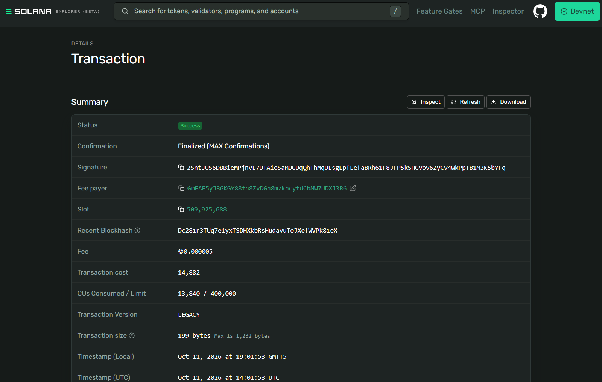
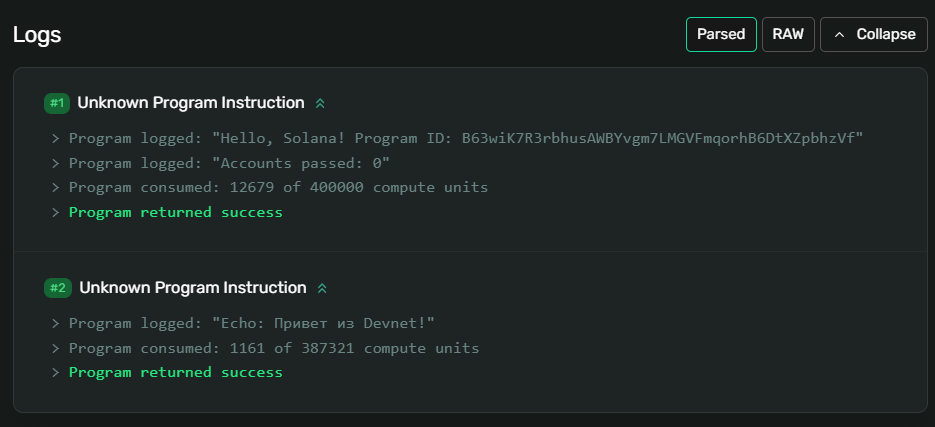

# Задание 4. Первая Solana-программа

Программа написана на Rust в Solana Playground и загружена в Devnet.

Поддерживает две инструкции:
- Hello — выводит приветствие и адрес программы.
- Echo — выводит текст, переданный клиентом.

Порядок запуска в Solana Playground:
1. Сборка программы: build
2. Загрузка в Devnet: deploy
3. Запуск клиента: run

Проверка: транзакция завершилась успешно. В логах отображаются
«Hello, Solana!» и «Echo: Привет из Devnet!».

## Результат в Devnet

Program ID: B63wiK7R3rbhusAWBYvgm7LMGVFmqorhB6DtXZpbhzVf

Программа:
https://explorer.solana.com/address/B63wiK7R3rbhusAWBYvgm7LMGVFmqorhB6DtXZpbhzVf?cluster=devnet

Транзакция вызова:
https://explorer.solana.com/tx/2SntJUS6D8BieMPjnvL7UTAioSaMUGUqQhThMqULsgEpfLefa8Rh61F8JFP5kSHGvov6ZyCv4wkPpT81M3K5bYFq?cluster=devnet

## Скриншоты

Успешная транзакция:

Логи выполнения Hello и Echo:

